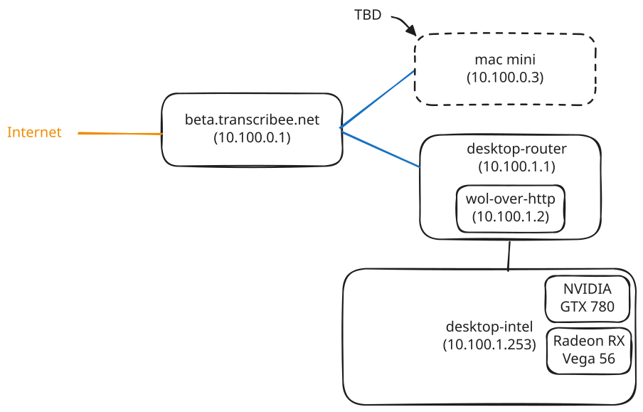

# Bugbakery Test Farm

This repository contains tools and documentation for the bugbakery setup for testing cross platform
desktop software.


## Setup

We have an internal wireguard network that connects most of our infrastructure. Our desktop
testing machines are located behind a router that terminates the wireguard network.
Our desktop testing machines are hosting virtual machines that are then used for testing.



## Usage

To spawn virtual machines and connect to them do (for example):

```sh
uv run main.py win11+intel
```

## Creating virtual harddrive

We maintain 3 flavors:

- cleaninstall: a clean installation of the os with generic system with nothing changed
- base: activated system with essentials like RDP and SSH and essential fixes (in most cases the starting point for new harddrives)
- main: the main harddrive used for testing, with all needed drivers, tools, etc.


### create win11-cleaninstall

- connect to host with VNC port forwarded
    ```sh
    ssh transcribee-ci-intel -L 5900:127.0.0.1:5900
    ```
- get win11 iso
    - https://www.microsoft.com/de-de/software-download/windows11
    - for x64 devices
    - language: **english (US)**
- create harddrive:
    ```sh
    qemu-img create -f qcow2 win11-cleaninstall.qcow2 100G
    ```
- run qemu (uses UEFI):
    ```sh
    qemu-system-x86_64-uefi --enable-kvm -M pc,usb=on,acpi=on,hpet=off -cpu host,hv_relaxed,hv_frequencies,hv_vpindex,hv_ipi,hv_tlbflush,hv_spinlocks=0x1fff,hv_synic,hv_runtime,hv_time,hv_stimer,hv_vapic -m 6G -smp cores=4 -drive file=win11-cleaninstall.qcow2 -device usb-tablet -device VGA,vgamem_mb=256 -nic user,model=e1000 -monitor stdio -display vnc=:0,password=on -cdrom Win11_25H2_English_x64_v2.iso
    ```
- run `set_password vnc admin` in qemu console to set VNC password to 'admin'
- connect to localhost:5900 via VNC client with password 'admin'
- run `system_reset` in qemu console to restart the VM and press a key via VNC to enter the windows setup
- bypass installation requirements
    - on language selection screen press 'Shift + F10' to open command prompt
    - run these commands:
        ```
        reg add HKLM\SYSTEM\Setup\LabConfig
        reg add HKLM\SYSTEM\Setup\LabConfig /t REG_DWORD /v BypassTPMCheck /d 1
        reg add HKLM\SYSTEM\Setup\LabConfig /t REG_DWORD /v BypassSecureBootCheck /d 1
        reg add HKLM\SYSTEM\Setup\LabConfig /t REG_DWORD /v BypassRAMCheck /d 1
        reg add HKLM\SYSTEM\Setup\LabConfig /t REG_DWORD /v BypassCPUCheck /d 1
        ```
- perform windows installation
    - keep US language, formats and keyboard layout
    - you don't have a product key
    - choose `Windows 11 Pro` as edition
- after the system rebooted, continue with windows setup
    - we do not want to use a Microsoft account, so we need to:
        - press 'Shift + F10' to open command prompt again
        - run `ncpa.cpl' and disable the network adapter
        - run `oobe\bypassnro.cmd`
        - the setup restarts
    - use US as region and keyboard layout
    - device name `testfarm-win11`
    - setup for 'personal use'
    - use username `bugbakery` and password `admin`
    - answer with `admin` to all security questions
    - uncheck all anti-privacy options
- when setup is completed enable network adapter and install updates
- cleanly shut down vm

### create win11-base

- connect to host with VNC port forwarded
    ```sh
    ssh transcribee-ci-intel -L 5900:127.0.0.1:5900
    ```
- get virtio windows driver iso
- create harddrive (based on win11-cleaninstall):
    ```sh
    qemu-img create -B qcow2 -b win11-cleaninstall.qcow2 -f qcow2 win11-base.qcow2
    ```
- run qemu (uses UEFI):
    ```sh
    qemu-system-x86_64-uefi --enable-kvm -M pc,usb=on,acpi=on,hpet=off -cpu host,hv_relaxed,hv_frequencies,hv_vpindex,hv_ipi,hv_tlbflush,hv_spinlocks=0x1fff,hv_synic,hv_runtime,hv_time,hv_stimer,hv_vapic -m 6G -smp cores=4 -drive file=win11-base.qcow2 -device usb-tablet -device VGA,vgamem_mb=256 -nic user,model=e1000 -monitor stdio -display vnc=:0,password=on -cdrom virtio-win.iso
    ```
- run `set_password vnc admin` in qemu console to set VNC password to 'admin'
- connect to localhost:5900 via VNC client with password 'admin'
- activate windows
    - download [MAS_AIO.cmd](https://raw.githubusercontent.com/massgravel/Microsoft-Activation-Scripts/refs/heads/master/MAS/All-In-One-Version-KL/MAS_AIO.cmd) and run it
    - select 3 for `TSForge Activation` and then 1 to activate windows
    - delete script
    - empty recycle bin
- enable RDP
    - Settings -> System -> Remote Desktop
- enable SSH
    - Settings -> System -> Optional Features -> View features -> See available features
    - select "OpenSSH Sever"
    - "Add"
    - open "Services" -> OpenSSH SSH Server
    - set `Startup type` to `Automatic`
- allow ICMP requests
    - open Windows Defender Firewall with Advanced Security
    - Inbound Rules
    - enable `Virtual Machine Monitoring (Echo Request - ICMPv4-In)`
    - enable `Virtual Machine Monitoring (Echo Request - ICMPv6-In)`
- uninstall Apps
    - WhatsApp
    - Outlook
    - Xbox
    - LinkedIn
    - Microsoft 365 Copilot
    - Xbox Live
    - Microsoft OneDrive
- install virtio drivers
    - go to CD Drive
    - run virtio-win-guest-tools
- disable auto updates
    - open comand prompt as administrator
    - run
        ```
        reg add HKEY_LOCAL_MACHINE\SOFTWARE\Policies\Microsoft\Windows\WindowsUpdate\AU /t REG_DWORD /v NoAutoUpdate /d 1
        ```
- cleanly shut down vm

### create win11-main

The main image may get new versions all the time, this is the setup to bootstrap it.

- start with symlink to win11-base
    ```
    ln -sf win11-base.qcow2 win11-main@HEAD.qcow2
    ```
- launch vm with `--edit-base-image` and all devices attached (`-d all`)
- install all missing driver using windows update
- on intel host:
    - install intel npu driver
- restart
- cleanly shut down vm

## Notes

### ubuntu: Get rid of nouveau firmware error

When getting something like this in `dmesg`:
```
Direct firmware load for nouveau/nvf0_fuc084 failed with error 2
```

Install firmware manually as described here: https://nouveau.freedesktop.org/VideoAcceleration.html#firmware

### install opencl for intel gpu

```sh
sudo apt-get install -y ocl-icd-libopencl1 intel-opencl-icd
```

### fix radeon vega 56 on windows

on host:

- disable "Re-Size BAR Support" in BIOS
- enable SR-IOV in BIOS

(https://wiki.archlinux.org/title/PCI_passthrough_via_OVMF/Troubleshooting)
